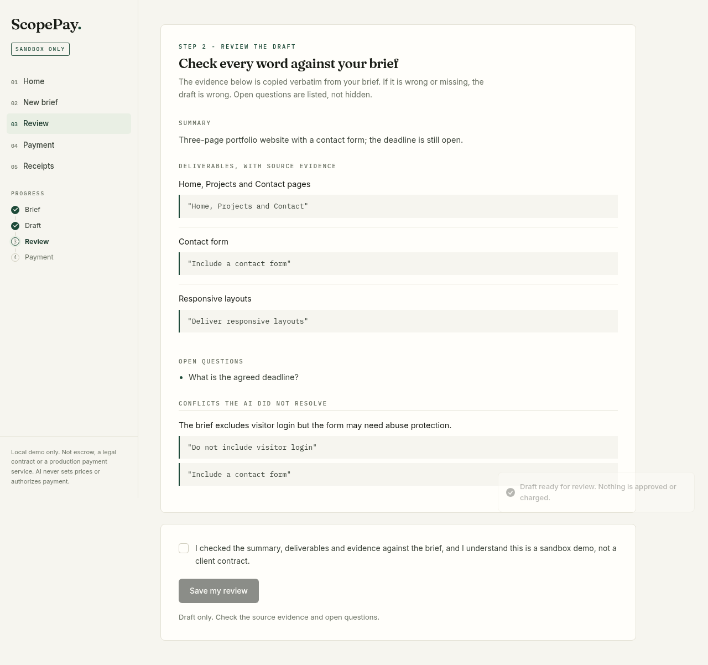
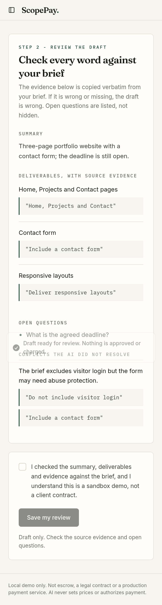
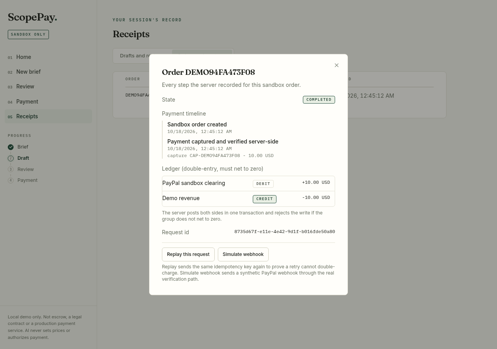
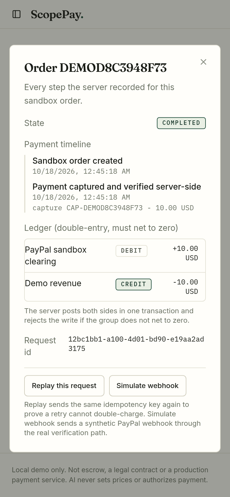

# ScopePay

A private PayPal AI hackathon prototype: turn a synthetic project brief into an evidence-linked scope draft, review it explicitly, then make a separate fixed-price sandbox payment. AI never prices work or approves payment.

Stack: **Spring Boot 3.3 (Java 21) + PostgreSQL** backend, **React + Vite + shadcn/ui (Tailwind v4)** frontend.

## What works in the local build

- Multi-page React interface (shadcn/ui): synthetic brief, draft summary, deliverables with exact source evidence, questions and conflicts, review, payment, receipts.
- Server-side extraction validation with clear disabled, timeout, refusal and invalid-output errors. No canned output masquerading as AI.
- Groq adapter for `openai/gpt-oss-20b`, strict JSON schema, separate system/brief messages, fixed endpoint, no tools or automatic retry, no paid fallback.
- Explicit review checkbox and server-saved review tied to the browser session in PostgreSQL.
- Server-enforced reviewed-scope gate before creating the fixed USD 10.00 demo order.
- PayPal sandbox SDK v6, Orders v2 create/capture, full-capture refunds, browser buyer approval, server-owned amount, session capability/origin checks, idempotency and stored completion receipt.
- Cancelled, declined, pending and uncertain outcomes are never marked completed.
- **Order state machine**: only `CREATING -> CREATED -> COMPLETED | PENDING_REVIEW -> COMPLETED`; anything else fails closed.
- **Double-entry ledger**: every completed capture posts a balanced debit/credit group in the same transaction; an unbalanced group rolls back. A refund posts the balanced reversal group, so the ledger always tells the full money story.
- **Transactional outbox**: every state change writes its audit event atomically; the Receipts page renders this trail as a per-order payment timeline with the ledger beside it.
- **Idempotency proof**: the Receipts order view can replay the same idempotency key live - the server returns the original order (HTTP 200), never a second PayPal order.
- **Webhook intake**: `/api/webhooks/paypal` verifies each transmission with PayPal's own verify endpoint before recording anything; forged or unverifiable webhooks are rejected and logged, and a webhook never moves order state.
- **Demo tools (local only, `DEMO_TOOLS=true`)**: webhook simulator through the real verification path, and failure-injection toggles (unclear capture, wrong amount, create outage) that drive the server's real fail-closed handling.
- **Resilience4j retry + circuit breaker on every PayPal call**: transient faults (5xx, 429, network) retry up to 3 times with exponential backoff; 4xx business errors never retry; the breaker opens at 60% failures and fails fast. Nothing about failure handling is silently swallowed.
- **Scheduled reconciler**: re-reads every `PENDING_REVIEW` order from PayPal each minute and completes it only when PayPal's own record proves a completed capture of exactly USD 10.00; any disagreement fails closed.
- **Actuator + Micrometer + Prometheus**: `/actuator/health`, `/actuator/metrics` and a `/actuator/prometheus` scrape with business counters (orders placed/completed/pending_review, webhooks confirmed/rejected, relay, rate limit) - loopback only.
- **Structured JSON logs with correlation IDs**: every request gets an `X-Correlation-Id` (echoed in the response) that appears on every log line.
- **OpenAPI + Swagger UI**: `/v3/api-docs` and `/swagger-ui/index.html` document the API.
- **Optional Redis rate limit (`SCOPEPAY_RATELIMIT_ENABLED=true`)**: sliding-minute per-session limit on mutating routes, fail-open when Redis is down, webhooks exempt. Off by default.
- **Optional Kafka outbox relay (`SCOPEPAY_KAFKA_RELAY_ENABLED=true`)**: publishes committed outbox events to the `scopepay.outbox` topic in order and marks `published_at`. Postgres stays the durable outbox; with the flag off the table is the whole contract. Off by default.

This is a local prototype, not a production service, escrow product, legal agreement or automatic charging system. The review acknowledges a draft for a simulated demo only, including open questions. It does not settle a client's requirements or create an obligation. No real service is sold and no real money moves.

## Why ScopePay

Freelancers lose money twice: unclear scopes that drift into disputes, and awkward payment collection after the work. ScopePay explores one fix for that: an AI that turns a plain-English brief into a structured scope draft where every deliverable links to its exact source evidence, a required human review of that draft, and only then a separate, explicit PayPal payment step. The AI reads and organizes; it never sets the price and never approves a charge. The human stays the decision-maker end to end.

## Built with, and how each tool is used

- **PayPal JavaScript SDK v6 + Orders v2 REST API (sandbox)**: browser buyer approval, server-side order create/capture with idempotency identifiers, receipt verification of status, amount and currency before anything is marked complete, full refunds of completed captures through the Payments v2 refunds endpoint with their own idempotency keys, and webhook signature verification.
- **Groq `openai/gpt-oss-20b`**: scope-draft extraction into a strict JSON schema, with verbatim evidence spans quoted from the brief. One fixed model and endpoint, no tool use, no automatic retries, no paid fallback; refusals and timeouts fail closed.
- **Spring Boot 3.3 (Java 21) + Spring Data JPA + Flyway**: loopback API, session capability checks, the review gate, order state machine, double-entry ledger and transactional outbox.
- **Resilience4j**: retry with exponential backoff and a circuit breaker around the PayPal client.
- **Spring Actuator + Micrometer + Prometheus**: health, metrics and a scrape endpoint with business counters.
- **springdoc-openapi**: generated OpenAPI document and Swagger UI.
- **Optional Spring Kafka relay + Spring Data Redis rate limit**: off by default, enabled with flags, the default demo path needs only PostgreSQL. Tested against embedded Kafka (KRaft) and embedded Redis.
- **JaCoCo**: coverage report at `backend/target/site/jacoco/index.html` after `mvn test`.
- **PostgreSQL 17**: durable drafts, reviews, orders, ledger entries and outbox events. Migrations in `backend/src/main/resources/db/migration`.
- **React + Vite + shadcn/ui (Tailwind v4, Radix)**: the multi-page interface - sidebar layout, evidence review, sandbox payment, receipts with tabs and the order detail dialog.

## What it looks like

| Desktop review flow | Mobile |
| --- | --- |
|  |  |

| Order timeline and ledger (desktop) | Order timeline (mobile) |
| --- | --- |
|  |  |

## Run

Java 21, Maven, Node 22+ and a local PostgreSQL (a free podman container works) are required. See [full setup, demo and troubleshooting](docs/LOCAL_RUN.md) - it is written one step at a time.

```bash
cp .env.example .env   # fill locally with sandbox credentials
set -a; source .env; set +a
cd backend && mvn test && mvn spring-boot:run
# new terminal:
cd client && npm ci && npm run dev
```

Open **http://localhost:5173**. API is loopback-only on port 8090.

Groq is disabled unless an API key and `GROQ_FREE_PLAN_CONFIRMED=true` are configured, with `AI_SYNTHETIC_ONLY=true`. Verify the account is Free, the fixed model is accessible and Zero Data Retention is enabled first. Do not add a card, buy credits or upgrade. Free limits are account-specific.

Never commit a filled `.env`, put secrets in screenshots or paste them into chat. No keys or test-account passwords are included. Only use synthetic briefs: the operator flag does not automatically detect private content.

## Verification, honestly scoped

[Verification record](docs/VERIFICATION.md) distinguishes automated proof, scripted stand-ins and checks still pending on the owner's machine.

- 90 JUnit tests pass (API, safety invariants, ledger, outbox, state machine, webhooks, AI adapter, reconciler, resilience, rate limit, Kafka relay, observability, real-PostgreSQL schema guard); production client build passes.
- Payment safety paths (idempotent create, fail-closed capture, amount check, state machine, ledger balance, webhook verify) are covered by tests with a stubbed PayPal.
- Screenshots in this README were taken against a scripted PayPal stand-in (test-only runner); the identical server code runs against the real sandbox with the owner's credentials.
- The earlier Node prototype's live sandbox flow (buyer approval, capture, independent seller receipt) was verified Oct 16, 2026; the Spring Boot rebuild re-verifies live on the owner's laptop before submission.

## Boundaries and remaining work

Keep the repository PRIVATE. Do not expose the app publicly: it lacks real user accounts, production authentication, durable rate limiting, TLS, deployment access controls and live payment rails. A session token is a local demo capability, not a login. Uncertain payment outcomes need manual sandbox activity inspection; do not create replacement orders blindly.

Submission deadline is November 12, 2026 at 12:00 Pacific (November 13, 01:30 IST). Public release, the demo video and the Devpost submission are separate owner steps. MIT was selected by the owner on October 16, 2026. No hackathon entry has been submitted.

## Architecture

See [architecture and trust boundaries](docs/ARCHITECTURE.md). The application remains a private local demo; release and submission are separate owner decisions.

## Official references

- https://paypalaihackathon.devpost.com/rules
- https://paypalaihackathon.devpost.com/resources
- https://developer.paypal.com/docs/api/orders/v2/
- https://developer.paypal.com/api/rest/webhooks/
- https://console.groq.com/docs/structured-outputs
- https://console.groq.com/docs/your-data

## License

[MIT](LICENSE). Copyright (c) 2026 Atul Upadhyay. Third-party dependencies and services retain their own terms. The repository remains private until public release is separately approved.
